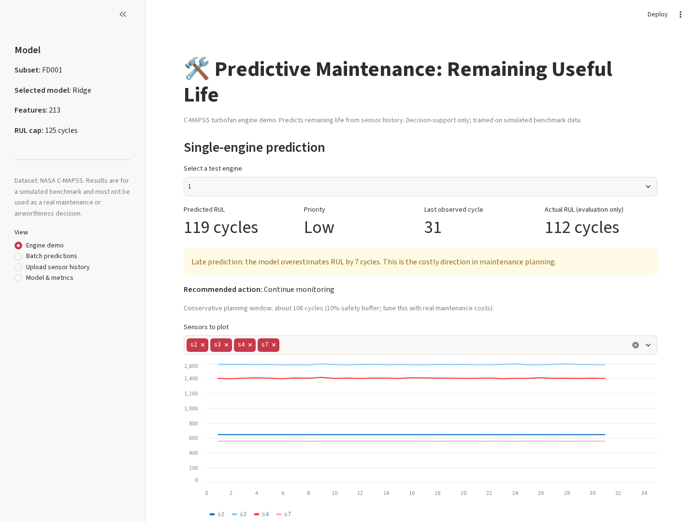

# Predictive Maintenance with Remaining Useful Life Estimation

A complete B.Tech-level machine-learning project using the **NASA C-MAPSS FD001** turbofan engine dataset. It predicts the remaining useful life (RUL) of an engine from multivariate sensor time series, compares several regression models, and ships with a Streamlit maintenance-planning prototype.

> **Problem statement (Project 46):** Estimate how long a machine can operate before maintenance becomes necessary.
>
> **Deliverable:** A reproducible RUL regression pipeline, model comparison, error analysis, figures, report, and interactive demo.

**Documentation:** [Full report](reports/PROJECT_REPORT.md) · [Data card](reports/DATA_CARD.md) · [Model card](reports/MODEL_CARD.md) · [Viva guide](reports/VIVA_QUESTIONS.md)

> **Scope:** This is an RUL **regression** project, not a fault-classification study. It uses engine-level splits, truncated validation, asymmetric scoring, and a maintenance-planning prototype.

---

## Interactive UI Preview



*The Streamlit prototype (`app/streamlit_app.py`) showing single-engine RUL prediction, maintenance priority, conservative planning window, and sensor trend plots.*

---

## Results at a glance

| Item | Value |
|---|---|
| Dataset | NASA C-MAPSS FD001 (100 train / 100 test engines) |
| Target | RUL in cycles, capped at 125 |
| Features | 213 engineered features from 15 sensors + 3 operating settings |
| Validation | 20 held-out engines, 5 truncation points each = 100 predictions |
| Selected model | Ridge regression |
| Test RMSE (capped RUL) | **14.89 cycles** |
| Test MAE (capped RUL) | **11.63 cycles** |
| Test R² | **0.862** |
| Test NASA score (mean, lower is better) | **3.20** |
| Late predictions on test | 50 / 100 |
| Test RMSE (raw official RUL) | 16.30 cycles |

**Ablation — why time-series features matter:**

| Feature set | Model | Test RMSE | Test NASA |
|---|---|---:|---:|
| Raw sensors + settings | Ridge | 20.59 | 12.29 |
| Engineered rolling features | Ridge | **14.89** | **3.20** |
| Raw sensors + settings | HistGradientBoosting | 17.33 | 9.67 |
| Engineered rolling features | HistGradientBoosting | 15.37 | 5.06 |

The engineered features cut Ridge's test RMSE by about 28% and its NASA score by about 74%.

---

## Quick start

```bash
python3 -m venv .venv
source .venv/bin/activate
pip install -r requirements.txt

# Download and extract the public NASA C-MAPSS files
python scripts/download_data.py

# Train, evaluate, and generate figures
python -m src.train --subset FD001

# Run the tests
python -m unittest discover -s tests -v

# Launch the prototype
streamlit run app/streamlit_app.py

# (Optional) Build a submission-ready Word report
pip install -r requirements-docs.txt
python scripts/build_report.py
```

Train another subset:

```bash
python -m src.train --subset FD002
```

Run a prediction from a CSV:

```bash
python -m src.predict --input data/sample_input.csv --output predictions.csv
```

The sample CSV is a 60-cycle slice of test engine 49; the model predicts about 20.6 cycles against a true RUL of 21.

Reproduce the two supporting analyses:

```bash
python scripts/ablation.py --subset FD001
python scripts/tune_ridge.py --subset FD001
```

---

## Project structure

```text
.
├── app/
│   └── streamlit_app.py          # interactive RUL demo
├── data/
│   ├── raw/CMAPSS/               # downloaded dataset (not tracked)
│   ├── README.md                 # data notes
│   └── sample_input.csv          # demo input
├── models/
│   └── rul_model.joblib          # saved model bundle (generated)
├── notebooks/
│   └── README.md                 # note on the script-based workflow
├── reports/
│   ├── PROJECT_REPORT.md         # full report (source)
│   ├── PROJECT_REPORT.docx       # generated Word version
│   ├── DATA_CARD.md              # dataset documentation
│   ├── MODEL_CARD.md             # model documentation
│   ├── VIVA_QUESTIONS.md         # viva preparation
│   └── figures/                  # generated PNG figures
├── results/
│   ├── metrics.json
│   ├── model_comparison.csv
│   ├── test_predictions.csv
│   ├── validation_predictions.csv
│   ├── error_by_rul_bin.csv
│   ├── feature_importance.csv
│   ├── feature_importance_permutation.csv
│   ├── ablation.csv
│   └── ridge_alpha_sweep.csv
├── scripts/
│   ├── download_data.py
│   ├── make_sample_input.py
│   ├── ablation.py
│   ├── tune_ridge.py
│   └── build_report.py
├── src/
│   ├── data.py                   # loading and validation
│   ├── features.py               # RUL target + rolling features
│   ├── modeling.py               # model zoo
│   ├── evaluation.py             # metrics and error analysis
│   ├── inference.py              # reusable prediction logic
│   ├── predict.py                # CLI prediction
│   ├── plots.py                  # report figures
│   └── train.py                  # end-to-end pipeline
├── tests/
│   └── test_pipeline.py
├── requirements.txt
├── requirements-docs.txt
└── README.md
```

---

## Methodology

### 1. Target definition

For a training engine that fails at cycle `T`, RUL at cycle `t` is `T - t`. The target is capped at **125 cycles** to create the standard piecewise-linear RUL target and avoid treating the long healthy period as a precise regression problem.

For the official test set, the model predicts one value at the last observed cycle of each engine. Metrics are reported against both the capped target (primary) and the raw official RUL (secondary).

### 2. Preprocessing

- Load space-separated C-MAPSS files with explicit column names.
- Drop six sensors that are constant in FD001: `s1`, `s5`, `s10`, `s16`, `s18`, `s19`.
- Keep 15 sensors plus the three operational settings.
- No rows are randomly split: the split is always by engine unit.

### 3. Feature engineering

For every sensor:

- first difference;
- rolling mean, standard deviation, minimum, and maximum over 10, 30, and 50 cycles.

All rolling features use only current and past cycles. The optional `--include-cycle` flag adds the raw cycle index, but it is off by default because it can become a shortcut.

### 4. Validation design

- 80 training engines / 20 validation engines.
- Each validation engine is truncated at **five random cycles** to mimic the official test set, producing 100 validation predictions.
- This is important: taking the last cycle of a full run-to-failure engine would always give RUL = 0 and would not represent test conditions.
- Model selection uses the average rank of validation RMSE and NASA score.
- The official test set is used only after model selection.
- The selected model is refit on all 100 non-test engines for the final artifact.

### 5. Models

- Mean RUL baseline
- Ridge regression
- Random Forest
- HistGradientBoosting
- XGBoost

Ridge won the validation comparison. The rolling-window features are strongly linearly informative, and the tree ensembles overfit the small engine-level validation set. Random Forest and XGBoost are still included to satisfy the “compare at least three algorithms” requirement and to show a genuine model comparison.

### 6. Metrics

- **RMSE** — main error magnitude.
- **MAE** — average error in cycles.
- **R²** — overall fit.
- **NASA/PHM asymmetric score** — penalises late predictions (over-estimated RUL) more than early predictions.
- **Late-prediction rate** — directly relevant to maintenance risk.

---

## Leakage prevention

This project explicitly avoids the common C-MAPSS mistakes:

- Engine-level train/validation/test split, never random row split.
- `RUL_FD001.txt` is never used during training.
- Rolling features use past data only.
- Imputers/scalers are fitted inside pipelines on training data only.
- Unit ID is not a feature.
- Cycle is excluded by default.
- Test engines are not used for model selection or hyperparameter tuning.
- Validation engines are truncated before evaluation.

See `tests/test_pipeline.py` for checks on RUL monotonicity, constant-sensor removal, feature alignment, and past-only rolling behaviour.

---

## Streamlit prototype

```bash
streamlit run app/streamlit_app.py
```

Pages:

1. **Engine demo** — select a test engine, inspect sensor trends, get predicted RUL, priority, actual RUL for evaluation, and a conservative planning window.
2. **Batch predictions** — score all test engines, prioritise maintenance, download CSV.
3. **Upload sensor history** — upload a CSV with `unit, cycle, op1..op3, s1..s21` and get predictions.
4. **Model & metrics** — validation comparison, test metrics, and report figures.

The app adds a 10% safety buffer when suggesting a planning window. This is illustrative; a real maintenance policy should tune the buffer using failure and downtime costs.

---

## Limitations and ethics

- C-MAPSS is **simulated** turbofan data, not a real fleet. Results demonstrate methodology, not deployment readiness.
- FD001 has one operating condition and one fault mode. FD002/FD004 are harder and more realistic.
- The model does not use maintenance history, cost data, or failure-mode labels.
- RUL uncertainty is not yet quantified; a production system should provide prediction intervals.
- Late predictions are dangerous. The NASA score and late-prediction rate are reported for this reason.
- This is decision-support only. It must not be presented as an airworthiness or safety-certified system.

---

## Dataset citation

> A. Saxena and K. Goebel (2008). "Turbofan Engine Degradation Simulation Data Set",
> NASA Prognostics Data Repository, NASA Ames Research Center, Moffett Field, CA.

Related paper:

> A. Saxena, K. Goebel, D. Simon, and N. Eklund, "Damage Propagation Modeling for
> Aircraft Engine Run-to-Failure Simulation," PHM 2008.

See `data/README.md` for source links and usage notes.

---

## Reproducibility checklist

- [x] Fixed random seed (`--seed 42`)
- [x] Exact feature definitions in `src/features.py`
- [x] Saved model bundle with feature list and metadata
- [x] Metrics, predictions, and figures saved under `results/` and `reports/figures/`
- [x] Download script for the public dataset
- [x] Unit tests
- [x] README with run instructions
- [x] Ethics and limitations section
