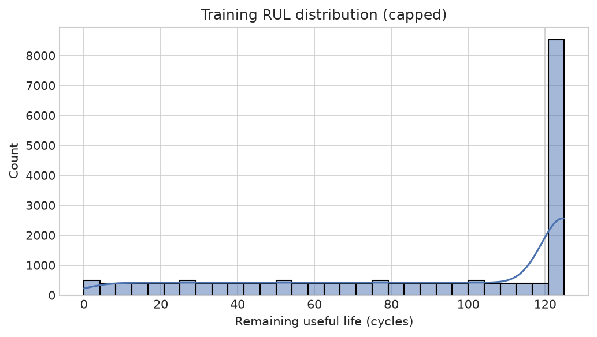
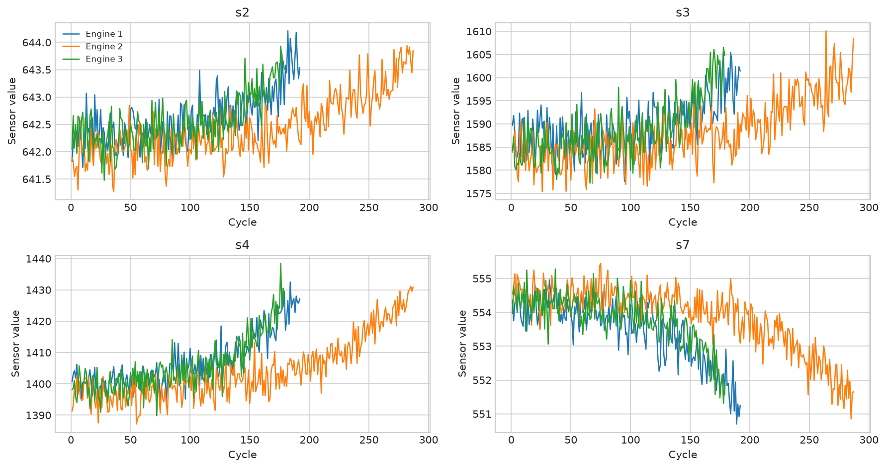
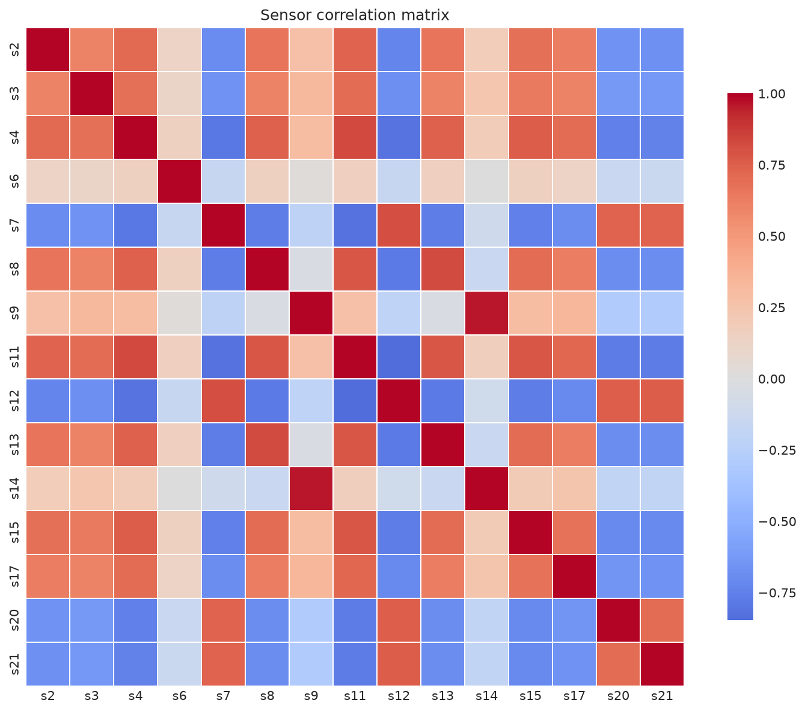
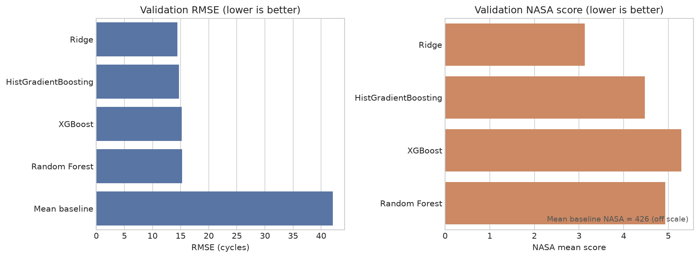
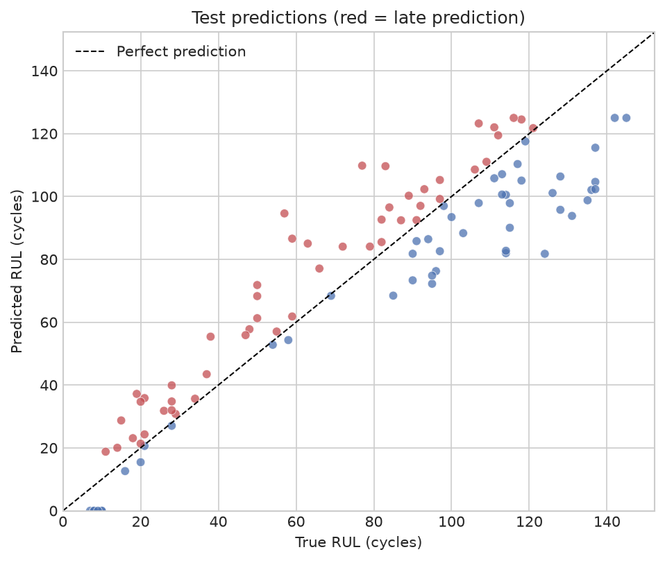
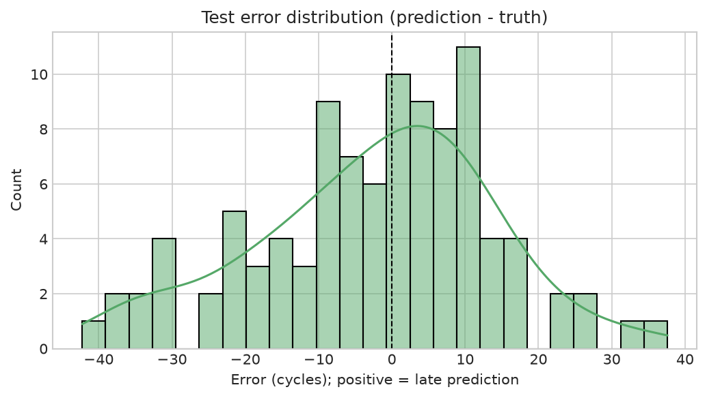
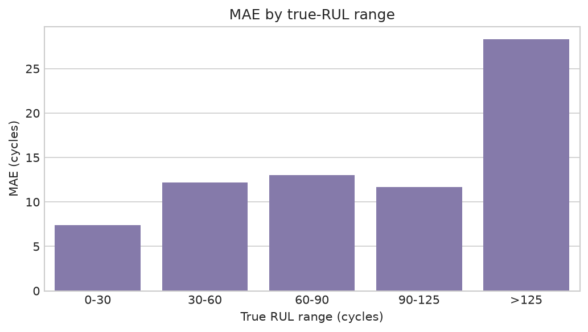
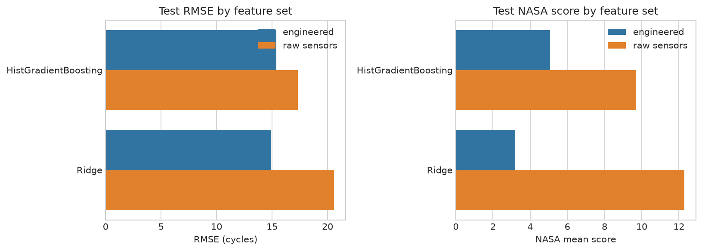
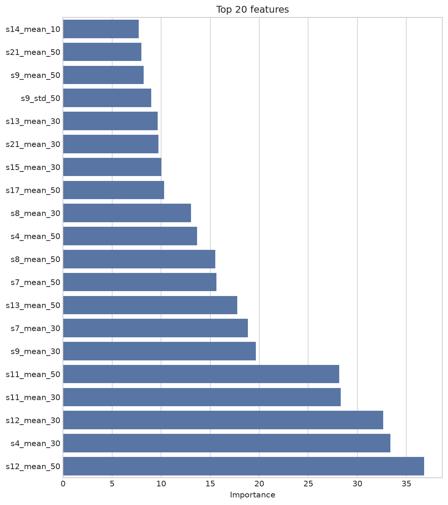

# Predictive Maintenance with Remaining Useful Life Estimation

### Project 46 — B.Tech Machine Learning Project

**Dataset:** NASA C-MAPSS FD001 turbofan engine degradation data  
**Task:** Remaining useful life (RUL) regression  
**Models:** Mean baseline, Ridge regression, Random Forest, HistGradientBoosting, XGBoost  
**Prototype:** Streamlit maintenance-planning application

---

## Abstract

Predictive maintenance aims to replace fixed maintenance schedules with
condition-based decisions. A central question is: *how many operating cycles
remain before this machine fails?* This project builds an end-to-end remaining
useful life (RUL) estimation system on the NASA C-MAPSS FD001 turbofan engine
benchmark. The target is RUL capped at 125 cycles. Each engine's sensor history
is converted into 213 features using first differences and rolling statistics
over 10-, 30-, and 50-cycle windows. Models are compared using an engine-level
split, and each held-out validation engine is truncated at five random cycles to
mimic the official test protocol. Five algorithms are evaluated: a mean
baseline, Ridge regression, Random Forest, HistGradientBoosting, and XGBoost.
Ridge regression is selected by average rank of validation RMSE and the
asymmetric NASA/PHM score. Refit on all 100 training engines, it achieves a test
RMSE of **14.89 cycles**, MAE of **11.63 cycles**, R² of **0.862**, and a mean
NASA score of **3.20** on the capped target. An ablation shows that engineered
rolling features reduce Ridge's test RMSE by about **28%** and its NASA score by
about **74%** compared with raw sensor values. A Streamlit prototype turns the
model into an interactive maintenance-prioritization demo with single-engine,
batch, and CSV-upload workflows.

---

## Table of contents

1. [Introduction](#1-introduction)
2. [Problem statement and scope](#2-problem-statement-and-scope)
3. [Dataset](#3-dataset)
4. [Methodology](#4-methodology)
5. [Results](#5-results)
6. [Prototype](#6-prototype)
7. [Reproducibility](#7-reproducibility)
8. [Limitations and ethics](#8-limitations-and-ethics)
9. [Conclusion and future work](#9-conclusion-and-future-work)
10. [References](#10-references)
11. [Appendix A — Requirement mapping](#appendix-a--requirement-mapping)
12. [Appendix B — Repository map](#appendix-b--repository-map)
13. [Appendix C — Command reference](#appendix-c--command-reference)

---

## 1. Introduction

Maintenance strategies generally fall into three groups:

- **Corrective maintenance:** repair after failure. Simple, but downtime and
  secondary damage can be expensive or dangerous.
- **Preventive maintenance:** service at fixed intervals. Reduces some failures,
  but often replaces healthy components and ignores actual condition.
- **Predictive maintenance (PdM):** use sensor data and models to estimate
  health and schedule maintenance when it is actually needed.

Remaining useful life is the quantitative core of PdM. If an engine has 25
cycles of useful life left, a planner can order parts, schedule a bay, and avoid
both premature replacement and in-service failure. RUL estimation is difficult
because degradation is gradual, sensor signals are noisy and correlated, and
failure is rare. It is a regression problem over time series, not a simple
snapshot classification problem.

The NASA C-MAPSS turbofan dataset is a standard public benchmark for this task.
It provides run-to-failure trajectories from a physics-based simulator, sensor
measurements, and official test labels. It is small enough to run on a laptop
and rich enough to require careful feature engineering, engine-level validation,
and asymmetric error analysis.

### 1.1 Objectives

1. Build a reproducible pipeline that loads C-MAPSS, constructs a capped RUL
   target, and engineers past-only time-series features.
2. Compare at least three regression algorithms under an engine-level split.
3. Select a model without touching the official test labels, then evaluate it
   once on the official test set.
4. Report error magnitude, fit, asymmetric cost, and late-prediction behaviour.
5. Quantify the value of rolling-window features with an ablation study.
6. Deliver a working interactive prototype and report-ready documentation.
7. Document limitations, ethical concerns, and leakage risks honestly.

### 1.2 Contributions

- A clean, modular implementation (`src/`) with data loading, feature
  engineering, modeling, evaluation, plotting, inference, and training entry
  points.
- A validation protocol that truncates held-out engines at multiple random
  cycles, avoiding the common mistake of evaluating on end-of-life rows with
  RUL = 0.
- A comparison of five algorithms, including a mean baseline and two gradient
  boosting implementations.
- An ablation that isolates the contribution of time-series features.
- A Streamlit prototype that converts predictions into maintenance priorities
  and a conservative planning window.
- Unit tests for target monotonicity, constant-sensor removal, feature
  alignment, past-only rolling behaviour, metric asymmetry, and prediction-table
  construction.

### 1.3 Scope and originality

This submission is an **RUL regression** study. It does not perform fault
classification or anomaly detection. The target, split protocol, validation
design, metrics, ablation, and prototype are specific to remaining-life
estimation:

- the label is cycles-to-failure, not a class;
- the split is by engine, not by row;
- validation engines are truncated at random cycles;
- the NASA asymmetric score and late-prediction rate are primary diagnostics;
- the prototype produces a maintenance priority and planning window.

All code and results in this repository were produced for this project. The
C-MAPSS dataset is cited and documented in `reports/DATA_CARD.md`; the model's
assumptions and boundaries are summarized in `reports/MODEL_CARD.md`. The raw
data are downloaded from NASA rather than redistributed.

---

## 2. Problem statement and scope

### 2.1 Formal problem

For engine \(i\), let \(x_{i,t}\) be the multivariate observation at cycle \(t\)
(three operational settings and 21 sensor values). Let \(T_i\) be the failure
cycle. The remaining useful life at cycle \(t\) is:

```text
RUL(i, t) = T_i - t
```

The learning task is to estimate a function:

```text
f(x_{i,1}, x_{i,2}, ..., x_{i,t}) -> RUL(i, t)
```

In practice, the function is approximated from a fixed set of engineered
features computed from the history up to cycle \(t\). The target used for
training is capped:

```text
y(i, t) = min(T_i - t, 125)
```

### 2.2 Why cap the target?

A run-to-failure engine can have more than 300 healthy cycles. Early in life,
sensor values are nearly flat. Asking a tabular model to distinguish 250 from
300 remaining cycles is difficult and mostly fits noise. Capping creates a
piecewise-linear target: the model focuses on the final 125 cycles, where
degradation is observable. This is standard in C-MAPSS work and is stated
explicitly rather than hidden.

The trade-off is that predictions are clipped to 125. Engines whose true RUL is
above 125 will be under-predicted, and their errors will look large if evaluated
against the raw label. For transparency, both capped and raw test metrics are
reported.

### 2.3 Primary subset

The project uses **FD001**:

- one operating condition (sea level),
- one fault mode (high-pressure compressor degradation),
- 100 training engines and 100 test engines.

FD001 is the cleanest subset and lets the project focus on feature engineering,
validation design, and error analysis. FD002 and FD004 introduce six operating
conditions, which require condition-wise normalization or operating-regime
features. FD003 adds a second fault mode. These are documented as extensions,
not silently ignored.

### 2.4 Success criteria

A useful model should:

- beat the mean baseline by a large margin;
- keep RMSE in the low-to-mid teens on the capped target;
- avoid systematically late predictions;
- have interpretable feature behaviour;
- be reproducible from a clean checkout;
- be honest about simulated-data limitations.

---

## 3. Dataset

### 3.1 C-MAPSS

C-MAPSS is a NASA turbofan engine simulator. The dataset contains multivariate
time series from engines that degrade until failure. Each row has:

| Column | Meaning |
|---|---|
| `unit` | Engine identifier |
| `cycle` | Operating cycle |
| `op1`, `op2`, `op3` | Operational settings |
| `s1`–`s21` | Sensor measurements |

The official test set contains truncated trajectories. The true RUL at the last
observed cycle of each test engine is provided separately. This design makes
the benchmark a genuine forecasting problem: the model must predict from a
partial history, not from a complete run-to-failure curve.

Full dataset documentation, checksums, and licensing notes are in
[`reports/DATA_CARD.md`](DATA_CARD.md).

### 3.2 FD001 statistics

| Property | Value |
|---|---:|
| Training engines | 100 |
| Test engines | 100 |
| Training rows | 20,631 |
| Test rows | 13,096 |
| Sensors | 21 (15 informative) |
| Operating settings | 3 |
| Train cycles per engine | 128–362 |
| Test cycles per engine | 31–303 |
| Raw training RUL | 0–361 |
| Official test RUL | 7–145 (mean 75.52) |

Six sensors are constant in FD001 and are removed using training statistics
only:

` s1, s5, s10, s16, s18, s19`

The 15 retained sensors are:

` s2, s3, s4, s6, s7, s8, s9, s11, s12, s13, s14, s15, s17, s20, s21`

### 3.3 Exploratory observations



The capped training target is concentrated near 125, with a tail toward zero.
This is expected: each engine contributes many healthy cycles and relatively few
near-failure cycles. A row-wise random split would therefore place many nearly
identical healthy rows in both train and validation, which is why the split is
by engine.



Several sensors show clear trends over an engine's life. For example, sensor 2
and sensor 3 drift upward, while sensor 4 and sensor 7 drift downward. The
trends are noisy, which motivates rolling statistics rather than raw values
alone.



Sensors are highly correlated. Trees can handle correlated inputs but may split
importance across them; Ridge uses all correlated signals with regularization.
This is one reason the linear model is competitive on FD001.

---

## 4. Methodology

### 4.1 Pipeline overview

```text
Raw C-MAPSS files
      |
      v
Load + validate columns
      |
      v
Capped RUL target (125)
      |
      v
Drop constant sensors (train statistics only)
      |
      v
Engine-level split: 80 train / 20 validation
      |
      v
Feature engineering: differences + rolling stats (10/30/50)
      |
      v
Train 5 models on 80 engines
      |
      v
Truncated validation: 5 cutoffs per engine -> 100 predictions
      |
      v
Select by average rank of RMSE and NASA score
      |
      v
Refit selected model on all 100 training engines
      |
      v
Official test: one prediction per test engine
      |
      v
Metrics, error analysis, figures, saved bundle
```

### 4.2 Target construction

For each training engine, the failure cycle is the maximum observed cycle. RUL
is computed by subtracting the current cycle and clipping at 125. The final row
of a run-to-failure engine therefore has RUL = 0, and RUL is non-increasing
within each engine. A unit test checks both properties.

### 4.3 Split protocol

**Training/validation split.** The 100 training engines are shuffled with a
fixed seed and split 80/20. No rows from a validation engine appear in the
training set.

**Validation truncation.** Evaluating on the last row of a run-to-failure
engine would always give RUL = 0 and would not resemble the official test set.
Instead, each validation engine is truncated at five random cycles between 25%
and 100% of its lifetime. This yields 100 validation predictions with a mix of
RUL values, similar to the official test distribution.

**Model selection.** Models are ranked by validation RMSE and by validation NASA
score. The average rank is used, with RMSE as a tie-breaker. The official test
set is not used for selection.

**Final refit.** After selection, the chosen pipeline is refit on all 100
training engines. The validation engines are included because their labels are
legitimate training data once selection is finished.

**Test evaluation.** Each test engine is scored once, at its last observed
cycle. Predictions are clipped to [0, 125].

### 4.4 Preprocessing

- Column names are assigned explicitly, since the raw files have no header.
- Files are parsed as whitespace-separated text.
- No missing values are present in FD001, but the pipeline includes median
  imputation so it remains robust to other subsets.
- Constant sensors are detected from the 100 training engines and removed from
  both train and test frames. This is unsupervised and never uses test data.
  The same six sensors have zero variance across every training engine, so the
  choice is identical for any engine-level split.
- `unit` and `cycle` are identifiers, not features. `unit` is never used.
  `cycle` is excluded by default.
- Scaling is applied only inside the Ridge pipeline, fitted on training data.

### 4.5 Feature engineering

For each of the 15 retained sensors, the pipeline computes:

| Feature family | Count per sensor | Purpose |
|---|---:|---|
| First difference | 1 | Local degradation rate |
| Rolling mean (10, 30, 50) | 3 | Smoothed level |
| Rolling std (10, 30, 50) | 3 | Signal volatility |
| Rolling min (10, 30, 50) | 3 | Recent floor |
| Rolling max (10, 30, 50) | 3 | Recent ceiling |
| **Total** | **13** | |

With 15 sensors, that is 195 sensor-derived features. Adding the three raw
operational settings gives 18 raw features and 213 total features:

```text
18 raw (15 sensors + 3 settings)
+ 15 differences
+ 15 sensors x 4 statistics x 3 windows = 180
= 213 features
```

All rolling operations use `min_periods=1`, so early cycles are handled without
dropping rows. Crucially, every window ends at the current cycle. No future
sensor value is used.

The optional `--include-cycle` flag adds the raw cycle index. It is off by
default because on run-to-failure data the cycle index can become a proxy for
the label and inflate validation scores. A per-engine normalization by maximum
cycle would be worse: it would use future information and would be inconsistent
between full training trajectories and truncated test trajectories.

### 4.6 Models

| Model | Role | Configuration |
|---|---|---|
| Mean baseline | Sanity check | Predicts the training mean |
| Ridge regression | Regularized linear model | α = 1.0, median imputation, standardization |
| Random Forest | Bagged nonlinear trees | 300 trees, `min_samples_leaf=2`, `max_features="sqrt"` |
| HistGradientBoosting | Histogram-based boosting | learning rate 0.05, 300 iterations, 31 leaves, L2 = 0.1 |
| XGBoost | Gradient-boosted trees | 400 trees, depth 5, learning rate 0.05, subsample 0.8, colsample 0.8, λ = 1.0 |

All models are scikit-learn pipelines so preprocessing is fitted only on the
training fold. XGBoost is optional: if the package is not installed, the
pipeline still runs with the other four models.

A small Ridge alpha sweep (0.01 to 1000) was performed on validation
(`scripts/tune_ridge.py`; results in `results/ridge_alpha_sweep.csv`). The curve
was flat between 0.01 and 3; α = 1.0 was kept as a reasonable default. No
extensive hyperparameter search was performed, because tuning many
configurations on 20 validation engines would overfit the selection set.

### 4.7 Metrics

Let \(y_i\) be the true RUL and \(\hat{y}_i\) the prediction.

**RMSE**

```text
RMSE = sqrt(mean((y - y_hat)^2))
```

Penalizes large errors and is the primary comparison metric.

**MAE**

```text
MAE = mean(|y - y_hat|)
```

Easy to interpret in cycles.

**R²**

```text
R² = 1 - SS_res / SS_tot
```

Measures explained variance. It is undefined for a single row, so it is computed
only on the multi-row test/validation sets.

**NASA/PHM asymmetric score**

With \(d = \hat{y} - y\):

```text
score = exp(-d / 13) - 1   if d < 0   (early prediction)
score = exp( d / 10) - 1   if d >= 0  (late prediction)
```

Lower is better. The asymmetry reflects maintenance risk: predicting more life
than remains can lead to in-service failure, so late errors are penalized more
than early errors. The mean score is reported per prediction; the sum is also
saved.

**Late-prediction rate**

```text
late_rate = mean(y_hat > y)
```

A direct measure of the costly error direction.

### 4.8 Leakage controls

The following controls are implemented and tested:

| Risk | Control |
|---|---|
| Same engine in train and validation | Split by `unit`, never by row |
| Future sensor values | Rolling windows are backward-looking only |
| Test labels used for tuning | Test set is scored only after model selection |
| Test statistics in preprocessing | Constant sensors and imputers use training data only |
| Cycle index as a shortcut | Excluded by default |
| Unit ID memorization | Excluded from features |
| Preprocessing outside CV | All preprocessing is inside pipelines |
| Validation at RUL = 0 only | Multiple random truncation points |
| Reporting only the best metric | RMSE, MAE, R², NASA score, late rate, and bins |

Unit tests cover target monotonicity, constant-sensor removal, feature
alignment, past-only rolling behaviour, cycle-feature safety, NASA asymmetry,
and prediction-table construction.

---

## 5. Results

### 5.1 Validation comparison

Validation uses 20 held-out engines and 5 truncation points per engine
(100 predictions). The selected model is marked in bold.

| Model | RMSE | MAE | R² | NASA mean | Late / 100 |
|---|---:|---:|---:|---:|---:|
| **Ridge** | **14.458** | 11.464 | **0.860** | **3.130** | 54 |
| HistGradientBoosting | 14.726 | **11.066** | 0.855 | 4.470 | 66 |
| XGBoost | 15.178 | 11.119 | 0.846 | 5.296 | 63 |
| Random Forest | 15.244 | 11.355 | 0.845 | 4.934 | 67 |
| Mean baseline | 42.050 | 34.702 | −0.181 | 425.863 | 58 |

Ridge has the lowest RMSE, the best R², and by far the best NASA score. Its MAE
is slightly worse than HistGradientBoosting's, but the gap is small (0.40
cycles), while Ridge's NASA score is 30% lower. The average-rank rule therefore
selects Ridge.

The mean baseline is deliberately included. A model that cannot beat the mean
baseline is not learning anything useful. All four real models beat it by a wide
margin.



The NASA-score panel excludes the mean baseline because its score (425.9) would
compress the scale; the baseline value is annotated in the figure.

### 5.2 Official test results

The selected Ridge pipeline was refit on all 100 training engines and evaluated
once on the 100 official test engines.

**Primary target: RUL capped at 125**

| Metric | Value |
|---|---:|
| RMSE | **14.892 cycles** |
| MAE | **11.635 cycles** |
| R² | **0.862** |
| NASA mean | **3.200** |
| NASA sum | 319.99 |
| Late predictions | 50 / 100 |
| Late rate | 0.50 |
| Mean error (pred − true) | −1.322 cycles |

**Secondary target: raw official RUL (uncapped)**

| Metric | Value |
|---|---:|
| RMSE | 16.301 cycles |
| MAE | 12.705 cycles |
| R² | 0.846 |
| NASA mean | 3.724 |
| Late predictions | 50 / 100 |
| Mean error | −2.392 cycles |

The raw-target RMSE is 1.41 cycles higher because 11 test engines have true RUL
above 125 and the model cannot predict above the cap. This is an expected
consequence of the target definition, not a separate model failure. The capped
target is the primary result because it matches training.

### 5.3 Predicted vs true RUL (raw official RUL)



Predictions follow the diagonal reasonably well for RUL below about 90. Above
that, the model compresses predictions toward the cap, which is expected. The
red points are late predictions; they occur on both sides of the diagonal, but
the model is not systematically optimistic overall (raw mean error is −2.39
cycles).

### 5.4 Error distribution (raw official RUL)



| Statistic | Raw official RUL | Capped at 125 |
|---|---:|---:|
| Mean | −2.39 | −1.32 |
| Median | +0.19 | +0.37 |
| Standard deviation | 16.21 | 14.91 |
| Minimum | −42.24 | −42.24 |
| 25th percentile | −12.53 | −9.62 |
| 75th percentile | +8.40 | +8.41 |
| Maximum | +37.60 | +37.60 |

Both columns use the same predictions; only the target used to compute the
error changes. The raw column shows the cap-induced negative tail, while the
capped column matches the primary metrics in Section 5.2. The distribution is
roughly centered but has a long left tail: the largest errors are
under-predictions on high-RUL engines. That is the safer direction for
maintenance, but it can cause unnecessary early replacement. The right tail is
shorter but more costly per error under the NASA score.

### 5.5 Error by raw true-RUL range



Bins use the raw official RUL so the `>125` group remains visible.

| True RUL range | n | MAE | RMSE | Late rate |
|---|---:|---:|---:|---:|
| 0–30 | 25 | 7.38 | 8.69 | 0.56 |
| 30–60 | 14 | 12.17 | 16.17 | 0.86 |
| 60–90 | 15 | 13.00 | 15.54 | 0.73 |
| 90–125 | 35 | 11.68 | 15.15 | 0.37 |
| >125 | 11 | 28.33 | 29.19 | 0.00 |

The model is most accurate near failure (MAE 7.38 cycles for RUL 0–30), which is
the most operationally important region. The >125 bin has a large MAE because
predictions are capped at 125; the errors are necessarily negative. The 30–90
range has the highest late rate, which is a useful warning: mid-life engines are
the hardest to rank correctly.

### 5.6 Ablation: raw sensors vs engineered features

To isolate the value of time-series feature engineering, the same validation
split and test protocol were used with two feature sets:

- **Raw sensors:** 3 operational settings + 15 sensors (18 features).
- **Engineered:** 213 features (differences + rolling statistics).

| Feature set | Model | Test RMSE | Test MAE | Test NASA |
|---|---|---:|---:|---:|
| Raw sensors | Ridge | 20.59 | 16.37 | 12.29 |
| Engineered | Ridge | **14.89** | **11.63** | **3.20** |
| Raw sensors | HistGradientBoosting | 17.33 | 12.14 | 9.67 |
| Engineered | HistGradientBoosting | **15.37** | **10.74** | **5.06** |



For Ridge, engineered features reduce test RMSE by **27.7%** and the NASA score
by **74.0%**. For HistGradientBoosting, the reductions are **11.3%** and
**47.7%**. The improvement is consistent across model families, which supports
the claim that the gain comes from the features rather than from a particular
algorithm.

This ablation is a post-hoc analysis. It is reported for interpretation and is
not used to select the final model.

### 5.7 Feature importance

Permutation importance was computed on the validation set using the selected
model. Values are the increase in RMSE (cycles) when a feature is shuffled,
averaged over five repeats.

| Rank | Feature | Importance (ΔRMSE) | Std. |
|---:|---|---:|---:|
| 1 | `s12_mean_50` | 36.82 | 1.85 |
| 2 | `s4_mean_30` | 33.38 | 2.43 |
| 3 | `s12_mean_30` | 32.62 | 2.29 |
| 4 | `s11_mean_30` | 28.32 | 2.02 |
| 5 | `s11_mean_50` | 28.15 | 1.56 |
| 6 | `s9_mean_30` | 19.64 | 1.84 |
| 7 | `s7_mean_30` | 18.84 | 1.80 |
| 8 | `s13_mean_50` | 17.76 | 1.08 |



The top features are all rolling means, not raw sensor values. This matches the
ablation: smoothing the degradation signal is more important than instantaneous
readings. Sensors 4, 7, 11, 12, and 13 are known to carry degradation
information in C-MAPSS. Correlated features can share importance, so the exact
ranking should not be read as a causal ranking.

### 5.8 Worst-case error analysis

| Unit | True RUL | Predicted | Error | Direction |
|---:|---:|---:|---:|---|
| 12 | 124 | 81.8 | −42.2 | Early |
| 21 | 57 | 94.6 | +37.6 | Late |
| 73 | 131 | 93.8 | −37.2 | Early |
| 47 | 135 | 98.8 | −36.2 | Early |
| 96 | 137 | 102.3 | −34.7 | Early |
| 89 | 136 | 102.1 | −33.9 | Early |
| 67 | 77 | 109.8 | +32.8 | Late |
| 83 | 137 | 104.6 | −32.4 | Early |

Two patterns stand out:

1. **High-RUL compression.** Most of the largest errors are under-predictions on
   engines with true RUL above 125. The cap and the model's regression toward
   the mean both push predictions down. This is safer than late prediction but
   can cause premature maintenance.
2. **Mid-life late predictions.** Units 21 and 67 are mid-life engines where the
   model overestimates remaining life by more than 30 cycles. These are the most
   dangerous individual errors and the ones a maintenance planner should review.

The model has no per-engine uncertainty estimate. A production system should
flag engines with unusual sensor trajectories or high predicted variance across
an ensemble, rather than relying on a single point prediction.

### 5.9 Discussion

Why did Ridge win? FD001 has one operating condition and one fault mode. The
rolling means produce a smooth, nearly monotonic degradation signal, and the
relationship between that signal and capped RUL is close to linear. With 80
training engines and many correlated features, a regularized linear model is
well matched to the problem. The tree ensembles can fit nonlinearities, but they
have more variance and overfit engine-specific quirks. This is a useful result:
a simple model with good features can beat a complex model with the same
features.

The gap between validation and test is small (14.46 vs 14.89 RMSE), which
suggests the selection procedure is not badly overfit. The test NASA score
(3.20) is also close to validation (3.13). This stability is more convincing than
a single low test score.

The late rate of 50% may look high, but it is simply the fraction of predictions
above the truth; the model is not systematically late in aggregate (mean error
−1.32 cycles). The asymmetric cost means even a well-centered model can produce
expensive late errors. A real deployment would choose a bias adjustment or
decision rule that trades off unnecessary maintenance against failure risk,
using actual cost data.

---

## 6. Prototype

The Streamlit app is the working prototype. It loads the saved model bundle and
the C-MAPSS test data, then exposes four views.

### 6.1 Engine demo

- Select any of the 100 test engines.
- Predict RUL at the last observed cycle.
- Show priority: **High** ≤ 20 cycles, **Medium** ≤ 50, **Low** > 50.
- Show the actual RUL for evaluation only.
- Warn explicitly when the prediction is late.
- Show a conservative planning window: predicted RUL minus a 10% buffer
  (minimum 2 cycles).
- Plot sensor trends and expose the raw history.

### 6.2 Batch predictions

- Score all test engines.
- Count High/Medium/Low priorities.
- Show predicted RUL, planning RUL, priority, recommended action, actual RUL,
  error, and late flag.
- Download the table as CSV.

### 6.3 Upload sensor history

- Upload a CSV with `unit`, `cycle`, `op1`–`op3`, and the trained sensor columns.
- Score one or many engines.
- Download predictions.
- A 60-cycle sample file is included at `data/sample_input.csv`.
- The rolling windows use up to 50 cycles; shorter uploads are scored with
  partial windows and should be treated as less reliable.

### 6.4 Model and metrics

- Test RMSE, MAE, R², NASA score, and late count.
- Validation comparison table.
- Report figures: model comparison, predictions, error distribution, error by
  RUL range, feature importance, and sensor trends.

### 6.5 Smoke test

The app was started headlessly and returned HTTP 200:

```bash
streamlit run app/streamlit_app.py --server.headless true --server.port 8599
```

The CLI prediction path was also verified on the sample input:

```text
unit 49, last cycle 303 -> predicted RUL 20.6, true RUL 21
```

The prototype is decision-support only. The 10% buffer is illustrative and
should be tuned with real failure and downtime costs.

---

## 7. Reproducibility

### 7.1 Environment

| Package | Version used |
|---|---|
| Python | 3.12 |
| pandas | 3.1.1 |
| NumPy | 2.5.5 |
| scikit-learn | 1.9.1 |
| XGBoost | 3.4.1 |
| matplotlib | 3.11.2 |
| seaborn | 0.13.2 |
| Streamlit | 1.67.0 |
| joblib | 1.6.0 |

`requirements.txt` lists compatible minimum versions.

### 7.2 Commands

```bash
# 1. Create an environment
python3 -m venv .venv
source .venv/bin/activate
pip install -r requirements.txt

# 2. Download and extract C-MAPSS
python scripts/download_data.py

# 3. Train, select, evaluate, and generate figures
python -m src.train --subset FD001

# 4. Run the tests
python -m unittest discover -s tests -v

# 5. Run the prototype
streamlit run app/streamlit_app.py

# 6. Predict from a CSV
python -m src.predict --input data/sample_input.csv --output predictions.csv

# 7. Reproduce the ablation
python scripts/ablation.py --subset FD001
```

### 7.3 Fixed configuration

| Setting | Value |
|---|---|
| Seed | 42 |
| Max RUL | 125 |
| Rolling windows | 10, 30, 50 |
| Validation fraction | 0.20 |
| Validation repeats | 5 |
| Cycle feature | disabled |
| Selection rule | average rank of RMSE and NASA score |

### 7.4 Artifacts

| Artifact | Path |
|---|---|
| Model bundle | `models/rul_model.joblib` |
| Metrics | `results/metrics.json` |
| Validation comparison | `results/model_comparison.csv` |
| Test predictions | `results/test_predictions.csv` |
| Validation predictions | `results/validation_predictions.csv` |
| Error by RUL bin | `results/error_by_rul_bin.csv` |
| Feature importance | `results/feature_importance.csv` |
| Permutation importance | `results/feature_importance_permutation.csv` |
| Ablation | `results/ablation.csv` |
| Ridge alpha sweep | `results/ridge_alpha_sweep.csv` |
| Figures | `reports/figures/` |
| Training log | `results/train_log.txt` |
| Word report | `reports/PROJECT_REPORT.docx` |
| Model card | `reports/MODEL_CARD.md` |

The model bundle stores the fitted pipeline, feature list, retained sensors,
window sizes, cap, subset, selected model name, metrics, and training timestamp.
Inference therefore does not depend on hard-coded feature names.

### 7.5 Reproducibility checklist

- [x] Fixed seed
- [x] Deterministic feature definitions
- [x] Engine-level split saved in code
- [x] All metrics saved as CSV/JSON
- [x] Model bundle contains feature metadata
- [x] Download script for public data
- [x] Data card with checksums
- [x] Unit tests
- [x] CLI prediction path
- [x] Streamlit smoke test
- [x] Ablation and Ridge alpha-sweep scripts
- [x] Word report build script
- [x] README with commands
- [x] Limitations and ethics documented

---

## 8. Limitations and ethics

### 8.1 Technical limitations

1. **Simulated data.** C-MAPSS is generated by a simulator. Real engines have
   different noise, maintenance actions, sensor faults, and operating profiles.
   The reported RMSE is a benchmark result, not a field guarantee.
2. **One operating condition.** FD001 has sea-level conditions. FD002/FD004
   include six conditions, where raw sensor values shift with operating regime.
   A model trained on FD001 would need condition-aware normalization before use
   on those subsets.
3. **One fault mode.** The model learns one degradation pattern. It is not a
   general fault diagnosis system.
4. **Capped target.** Predictions above 125 are clipped. The raw-target metrics
   show the cost of this choice.
5. **Single point prediction.** No prediction interval or uncertainty estimate
   is produced. A production system should quantify confidence.
6. **Small validation set.** Twenty engines is enough for a student project but
   not for reliable hyperparameter selection. Repeated engine-level splits or
   nested cross-validation would be more robust.
7. **Post-hoc test ablation.** The ablation uses the test set for reporting. It
   does not drive model selection, but it is still a form of repeated test use.
8. **No cost model.** Priority thresholds (20/50 cycles) and the 10% planning
   buffer are illustrative. Real decisions depend on downtime, part cost,
   inspection capacity, and failure consequences.
9. **Classical models only.** No sequence model (LSTM, TCN, Transformer) is
   included. The project prioritizes a transparent, reproducible baseline over
   a deep-learning benchmark.
10. **No drift monitoring.** A deployed system would need input-distribution
    checks and periodic retraining.

### 8.2 Ethical considerations

- **Safety-critical context.** RUL predictions can influence maintenance of
  aircraft engines. A late prediction can contribute to in-service failure.
  The model must be decision-support only, with human oversight and conservative
  buffers.
- **Uncertainty and accountability.** A single number without uncertainty can be
  over-trusted. The interface shows the actual RUL only for evaluation, warns on
  late predictions, and labels the planning window as conservative.
- **Transparency.** The report documents the target cap, split protocol, metrics,
  leakage controls, and failure cases. The model bundle stores its feature list
  and configuration.
- **Data ethics.** C-MAPSS contains no personal data. The raw data are publicly
  distributed by NASA; the project cites the source and does not claim ownership.
- **Benchmark honesty.** The results are presented as FD001 benchmark results.
  They should not be marketed as evidence of airworthiness or fleet readiness.
- **Fair use of maintenance resources.** Early predictions can cause unnecessary
  maintenance. The report discusses both error directions rather than optimizing
  only RMSE.

---

## 9. Conclusion and future work

This project delivered a complete RUL estimation workflow on NASA C-MAPSS FD001:
data loading, target construction, leakage-safe feature engineering, an
engine-level validation protocol, a five-model comparison, error analysis,
ablation, a saved model, and a working Streamlit prototype. Ridge regression
with rolling-window features achieved a capped-target test RMSE of 14.89 cycles,
MAE of 11.63 cycles, R² of 0.862, and a NASA score of 3.20. The ablation showed
that time-series features are the main driver of performance, cutting Ridge's
test RMSE by about 28% and its NASA score by about 74% relative to raw sensors.

The most important lesson is methodological: on C-MAPSS, a careful split and
past-only features matter more than model complexity. The project also shows the
value of reporting asymmetric error and late-prediction behaviour, not just
RMSE.

Future work:

1. **Multi-condition subsets.** Extend to FD002/FD004 with operating-regime
   clustering or condition-wise normalization.
2. **Sequence models.** Compare LSTM, TCN, and Transformer encoders against the
   feature-based baseline.
3. **Uncertainty.** Add quantile regression, conformal prediction, or Bayesian
   methods to produce prediction intervals.
4. **Cost-sensitive decisions.** Replace fixed priority thresholds with an
   optimization that uses downtime and failure costs.
5. **Robust validation.** Use repeated engine-level splits or nested
   cross-validation to reduce selection variance.
6. **Drift and monitoring.** Add input-distribution checks and a retraining
   schedule for deployment.
7. **Field validation.** Test on real fleet data before making any operational
   claim.

---

## 10. References

1. A. Saxena and K. Goebel, "Turbofan Engine Degradation Simulation Data Set,"
   NASA Prognostics Data Repository, NASA Ames Research Center, 2008.
2. A. Saxena, K. Goebel, D. Simon, and N. Eklund, "Damage Propagation Modeling
   for Aircraft Engine Run-to-Failure Simulation," *International Conference on
   Prognostics and Health Management (PHM)*, 2008.
3. F. O. Heimes, "Recurrent Neural Networks for Remaining Useful Life
   Estimation," *International Conference on Prognostics and Health Management
   (PHM)*, 2008.
4. S. Zheng, K. Ristovski, A. Farahat, and C. Gupta, "Long Short-Term Memory
   Network for Remaining Useful Life Estimation," *IEEE International
   Conference on Prognostics and Health Management (ICPHM)*, 2017.
5. X. Li, Q. Ding, and J.-Q. Sun, "Remaining Useful Life Estimation in
   Prognostics Using Deep Convolution Neural Networks," *Reliability
   Engineering & System Safety*, vol. 172, pp. 1–11, 2018.
6. X.-S. Si, W. Wang, C.-H. Hu, and D.-H. Zhou, "Remaining Useful Life
   Estimation — A Review on the Statistical Data Driven Approaches," *European
   Journal of Operational Research*, vol. 213, no. 1, pp. 1–14, 2011.
7. Y. Lei, N. Li, L. Guo, N. Li, T. Yan, and J. Lin, "Machinery Health
   Prognostics: A Systematic Review from Data Acquisition to RUL Prediction,"
   *Mechanical Systems and Signal Processing*, vol. 104, pp. 799–834, 2018.
8. F. Pedregosa et al., "Scikit-learn: Machine Learning in Python," *Journal of
   Machine Learning Research*, vol. 12, pp. 2825–2830, 2011.
9. T. Chen and C. Guestrin, "XGBoost: A Scalable Tree Boosting System,"
   *Proceedings of the 22nd ACM SIGKDD International Conference on Knowledge
   Discovery and Data Mining*, 2016.
10. Streamlit documentation, `https://docs.streamlit.io/` (accessed November
    2026).

---

## Appendix A — Requirement mapping

| Project requirement | Where addressed |
|---|---|
| Clear problem statement | Section 2; README problem statement |
| Dataset documentation | Section 3; `reports/DATA_CARD.md` |
| At least three algorithms | Section 4.6; five models compared |
| Proper train/validation/test protocol | Sections 4.3, 4.8; engine-level split and truncated validation |
| Evaluation with multiple metrics | Sections 4.7, 5.2; RMSE, MAE, R², NASA score, late rate |
| Error analysis | Sections 5.4–5.8; bins, worst cases, ablation |
| Working prototype | Section 6; `app/streamlit_app.py` |
| Reproducibility | Section 7; requirements, scripts, seeds, tests |
| Ethics and limitations | Section 8 |
| Report-ready figures | `reports/figures/` |
| Viva preparation | `reports/VIVA_QUESTIONS.md` |
| Code quality | Modular `src/` package, tests, docstrings |

---

## Appendix B — Repository map

```text
.
├── app/
│   └── streamlit_app.py          # interactive prototype
├── data/
│   ├── raw/CMAPSS/               # downloaded data (not tracked)
│   ├── README.md                 # data notes
│   └── sample_input.csv          # demo input
├── models/
│   └── rul_model.joblib          # saved model bundle
├── notebooks/
│   └── README.md                 # script-based workflow note
├── reports/
│   ├── PROJECT_REPORT.md         # this report
│   ├── PROJECT_REPORT.docx       # generated Word version
│   ├── DATA_CARD.md              # dataset documentation
│   ├── MODEL_CARD.md             # model documentation
│   ├── VIVA_QUESTIONS.md         # viva preparation
│   └── figures/                  # generated figures
├── results/
│   ├── metrics.json
│   ├── model_comparison.csv
│   ├── test_predictions.csv
│   ├── validation_predictions.csv
│   ├── error_by_rul_bin.csv
│   ├── feature_importance.csv
│   ├── feature_importance_permutation.csv
│   ├── ablation.csv
│   ├── ridge_alpha_sweep.csv
│   └── train_log.txt
├── scripts/
│   ├── download_data.py
│   ├── make_sample_input.py
│   ├── ablation.py
│   ├── tune_ridge.py
│   └── build_report.py
├── src/
│   ├── data.py                   # loading and validation
│   ├── features.py               # target and rolling features
│   ├── modeling.py               # model zoo
│   ├── evaluation.py             # metrics and error analysis
│   ├── inference.py              # reusable prediction logic
│   ├── predict.py                # CLI prediction
│   ├── plots.py                  # report figures
│   └── train.py                  # end-to-end pipeline
├── tests/
│   └── test_pipeline.py
├── requirements.txt
├── requirements-docs.txt
└── README.md
```

---

## Appendix C — Command reference

| Task | Command |
|---|---|
| Download data | `python scripts/download_data.py` |
| Train FD001 | `python -m src.train --subset FD001` |
| Train FD002 | `python -m src.train --subset FD002` |
| Run tests | `python -m unittest discover -s tests -v` |
| Run app | `streamlit run app/streamlit_app.py` |
| Predict from CSV | `python -m src.predict --input data/sample_input.csv --output predictions.csv` |
| Run ablation | `python scripts/ablation.py --subset FD001` |
| Run alpha sweep | `python scripts/tune_ridge.py --subset FD001` |
| Make sample input | `python scripts/make_sample_input.py` |
| Build Word report | `pip install -r requirements-docs.txt && python scripts/build_report.py` |

Training options:

```text
--subset {FD001,FD002,FD003,FD004}
--data-dir PATH
--max-rul 125
--windows 10 30 50
--include-cycle
--val-fraction 0.2
--val-repeats 5
--seed 42
--output-dir results
--model-dir models
--figure-dir reports/figures
--no-plots
--permutation-repeats 5
```
